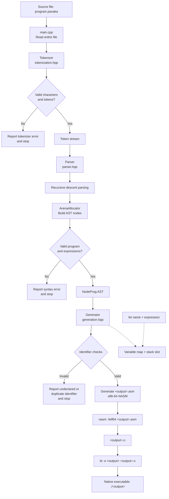

# Pavaka Compiler Flow

Pavaka is a small compiler pipeline. It accepts one `.pavaka` source file, turns it
into x86-64 assembly, and uses NASM and `ld` to produce a native executable.



## What each stage does

1. **Input (`src/main.cpp`)**: Requires an input path (e.g. `pavakac test.pavaka -o test`), reads the file,
   and passes its contents to the tokenizer.
2. **Tokenization (`src/tokenization.hpp`)**: Converts keywords (`let`, `string`,
   `char`, `int`, `if`, `else`, `print`, `exit`), identifiers, literals (integer,
   character with escape sequences, string with escape sequences), and punctuation
   (`=`, `==`, `!=`, `<`, `<=`, `>`, `>=`, `+`, `-`, `*`, `/`, `(`, `)`, `{`, `}`,
   `$`, `,`, `;`) into `Token` values.
3. **Parsing (`src/parser.hpp`)**: Consumes the token vector with recursive-descent
   functions for terms, expressions, statements, and blocks. Uses Pratt parsing
   to construct binary expressions with proper precedence (`* /` > `+ -` > `< <= > >=` > `== !=`).
4. **AST Storage (`src/arena.hpp`)**: Parser nodes are allocated from one 4 MiB
   linear bump arena, allowing rapid node allocation and zero-overhead teardown.
5. **Code Generation (`src/generation.hpp`)**: Walks the AST using visitors.
   - Allocates string literals into `section .data` with null terminators.
   - Evaluates arithmetic and comparisons using `rax`/`rbx` and machine stack.
   - Manages variable mappings and stack frame offsets.
   - Handles lexical scopes `{ ... }` with stack cleanup (`add rsp, N*8`).
   - Translates `if`, `else if`, and `else` blocks into conditional jumps (`cmp`, `je`, `jmp`).
   - Emits formatted printing routines for `int`, `char`, and `string`.
6. **Assembly and Linking (`src/main.cpp`)**: Writes `<output>.asm`, assembles it into
   `<output>.o` with NASM, and links it with `ld` into the native `<output>` executable.

## Example Path

For `test.pavaka`:

```pavaka
let x = (280) / 2;
let string a = "I no pata...";

{
    print("I no pata");
    let y = 3;
    x = x + y;
}

let z = 10;
if (z == 1) {
    print("z is 1");
} else if (z == 10) {
    print("z is ten!");
} else {
    print("fallback else");
}

print(a);
exit(x);
```

The compiler tokenizes all declarations, prints, conditionals, and expressions,
builds the AST, generates NASM assembly that computes `x = 143`, evaluates
the conditionals and prints results to stdout, and produces a native executable
exiting with status code `143`.