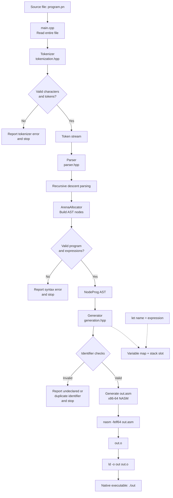

# Void Compiler Flow

Void is a small compiler pipeline. It accepts one `.pn` source file, turns it
into x86-64 assembly, and uses NASM and `ld` to produce a native executable.



## What each stage does

1. **Input (`main.cpp`)**: requires exactly one input path, reads the file,
   and passes its contents to the tokenizer.
2. **Tokenization (`tokenization.hpp`)**: converts keywords (`let`, `exit`),
   identifiers, integer literals, and punctuation such as `=`, `+`, `(`, `)`,
   and `;` into `Token` values. Whitespace is ignored.
3. **Parsing (`parser.hpp`)**: consumes the token vector with recursive-descent
   functions for terms, expressions, and statements. It creates a `NodeProg`
   AST whose statements are `let` declarations or `exit` calls.
4. **AST storage (`arena.hpp`)**: parser nodes are allocated from one 4 MiB
   arena, so the parser can create related nodes without individual deletes.
5. **Code generation (`generation.hpp`)**: walks the AST using visitors. Integer
   expressions and additions are evaluated with `rax`/`rbx` and the machine
   stack. `let` bindings are recorded in a variable map and resolved to stack
   offsets.
6. **Assembly and linking (`main.cpp`)**: writes `out.asm`, assembles it into
   `out.o` with NASM, and links it with `ld` into the `out` executable.

## Example path

For `test.pn`:

```text
let x = 139 + 4;
exit (x);
```

The compiler tokenizes the declaration and exit call, builds an addition AST,
generates code that computes `139 + 4`, stores the result on the stack, loads
`x` for the exit syscall, and produces an executable that exits with status
`143`.

## Current language boundary

The implemented compiler currently supports integer literals, identifiers,
`let` declarations, addition, and `exit`. The parser does not currently use
parenthesized expressions as a general expression form; the parentheses in
`exit (x);` belong to the `exit` statement syntax. There is no separate type
checking or optimization pass yet.